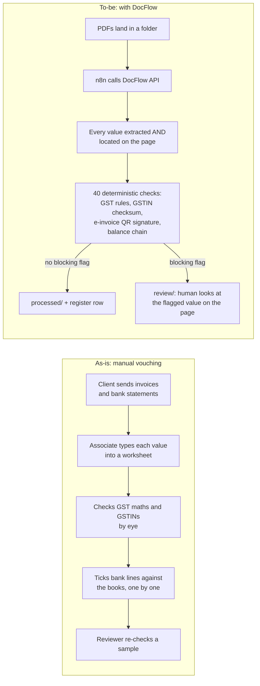

# DocFlow

**Reads GST invoices and bank statements, proves where every value is printed, and runs the checks an auditor would.** It is built for audit vouching: instead of typing every invoice into a worksheet and eyeballing the GST maths, the auditor looks only at the documents DocFlow flags, and every flag says which value is wrong and where it is printed.

- **Live demo:** _Streamlit link goes here after deploy_ (cached results, no login, no API key)
- **Held-out results:** invoice fields 99.1% correct, 16/16 planted defects caught; bank-statement lines 90.3% correct, 8/8 defects caught. Misses are stated below.
- **Automation:** an n8n workflow watches a folder, calls DocFlow's API, files each document as clean, needs review or failed, and keeps an Excel register.

The tool never approves anything; a human does.

---

## The process it changes



What changes for the associate:
- **Typing goes away.** Values are extracted and each one shows the exact words it came from.
- **Checking becomes exception review.** The associate opens only the documents that fail a check, and the flag message says what is wrong, for example "Row 31: previous balance 13,81,491.59 + credit 3,809.70 = 13,85,301.29, but the statement prints 13,86,301.29."
- **Nothing is silently trusted.** A value that cannot be found on the page is never used, and a QR signed by the government portal overrides what is printed.

ROI: see [`results/roi.md`](results/roi.md), a stopwatch comparison of manual vouching vs DocFlow plus review time.

## How it works

```
PDF ─► text layer? ─ yes ─► PyMuPDF words + boxes ─────────────┐
                    no ─► 300 dpi render ► deskew ► RapidOCR ──┤
                                                               ▼
     words serialised with IDs  "[w12]GSTIN [w13]27AAACU2414K1ZF"
                                                               ▼
  Mistral Small (structured output, T=0) returns {text as printed, word IDs} per field
                                                               ▼
  grounding: the text must be found at those words, or the value is UNGROUNDED (never trusted)
                                                               ▼
  independent second sources: label-anchored rule extractor · signed e-invoice QR (RS256, NIC keys)
                                                               ▼
  deterministic checks (CHECKS.md) ─► Flags ─► API / demo / Excel / n8n
```

Design decisions that matter:
- **The LLM never does arithmetic or conversions.** It returns text as printed plus word IDs, and Python parses amounts (Indian lakh grouping, OCR repairs), dates and rates.
- **Evidence is proven, not claimed.** Every value is matched back to the page words. Status is one of VERIFIED (a second, independent source agrees), GROUNDED, CONFLICT, UNGROUNDED or MISSING. No LLM "confidence" is used anywhere.
- **Bank statement tables are parsed deterministically.** The header is mapped to roles (Withdrawal / Debit / Dr all mean debit), and words are assigned to columns by position. An earlier LLM-only version swapped debits and credits, so the parser took over: dev lines fully correct went from 52.7% to 93.4%, and 97.1% after the OCR fixes that followed.
- **E-invoice QR codes are verified offline** against NIC's published certificates (`trust/nic/`, provenance in `SOURCES.json`). NIC's own 2020 sample QR verifies. A key DocFlow does not hold is reported as "cannot verify", never as tampering.
- **Prompt injection:** an invoice telling the model to "approve this invoice" changes nothing, because extraction is grounded and the checks are code.

## Results (held-out, run once)

The test data is synthetic, because real client documents cannot be published. 120 invoices in 4 layouts and 30 bank statements in 6 layouts, digital and scanned, with planted defects. All tuning used the **dev** split only; the **held-out** split was run exactly once, at the end ([`RUN_LOG.md`](RUN_LOG.md)).

**Invoices** (83 held-out, 42 scanned) · [`report`](results/2026-10-17/heldout/report.md)

| Metric | Held-out |
|---|---|
| Field accuracy | 99.1% |
| Key fields (GSTINs, number, date, totals) | 99.8% |
| Values proven on the page | 99.4% |
| Planted defects caught | **16/16** |
| Clean invoices wrongly flagged | 5/65 (7.7%) |
| LLM cost per document | ≈ $0.001 |

**Bank statements** (20 held-out, 7 scanned) · [`report`](results/2026-10-17/statements-heldout/report.md)

| Metric | Held-out |
|---|---|
| Statement lines fully correct (date, amount, direction, balance, reference) | 90.3% |
| By scan quality | digital 99.8% · light scan 99.6% · **heavy scan 71.4%** |
| Planted defects caught (broken balance chain, closing mismatch, row with both Dr and Cr, date outside period) | **8/8** |
| Clean statements wrongly flagged | 3/12 (all heavy scans) |

**Misses, stated plainly:**
- **Heavy scans are the weak spot.** Every wrong flag on held-out came from a heavily degraded scan, except one extra E1 on a digital invoice. They go to a human rather than through, which is the safe direction, but sometimes for the wrong reason.
- **One statement (heavy scan, Kotak-like layout) parsed 0/90 lines.** OCR merged the narrow row-number column into the date ("45 14 Jul 2026") and misread the month, so the rows were not recognised.
- **"VERIFIED" is weaker on scans.** On one scan the rule extractor agreed with the LLM on a mis-OCR'd GSTIN, because both read the same OCR text, and the field was marked VERIFIED. The GSTIN checksum check still caught it.
- **QR-vs-printed IRN (Q3) can be tripped by OCR.** On a heavy scan, 2 misread characters of the 64-character IRN raised Q3.

## Skills this shows

| Skill (from the internship listing) | Where |
|---|---|
| Python | [`src/docflow/`](src/docflow), 230+ tests in [`tests/`](tests) |
| LLM APIs | [`extract.py`](src/docflow/extract.py): Mistral structured output, retries, cache, prompt trace |
| Prompt engineering | [`prompts/`](prompts): versioned prompts, word-ID grounding, injection resistance ([`test_prompt_injection.py`](tests/test_prompt_injection.py)) |
| OCR / document processing | [`ocr.py`](src/docflow/ocr.py), [`ingest.py`](src/docflow/ingest.py): RapidOCR, deskew, orientation, OCR repairs |
| Data extraction | [`statement_table.py`](src/docflow/statement_table.py), [`narration.py`](src/docflow/narration.py) (UTR/RRN), [`rules.py`](src/docflow/rules.py) |
| Quality checks | [`CHECKS.md`](CHECKS.md): GST Rule 46, tax maths, GSTIN checksum, e-invoice QR signature, balance chain, each with its source |
| API integration | [`api.py`](src/docflow/api.py): FastAPI `POST /extract`; [`qr.py`](src/docflow/qr.py): NIC e-invoice signature verification |
| Workflow automation (n8n) | [`n8n/`](n8n): folder → API → IF → file + Excel register, tested end to end |
| Process mapping | The as-is / to-be map above |
| ROI measurement | [`results/roi.md`](results/roi.md) |
| Evaluation discipline | [`evaluate.py`](src/docflow/evaluate.py), dev/held-out split, [`RUN_LOG.md`](RUN_LOG.md) |

## Run it

Python 3.12 with [uv](https://docs.astral.sh/uv/). A Mistral API key is needed only for documents that are not already cached.

```bash
uv sync
```

```bash
uv run pytest -q
```

Process one document (prints the full result as JSON):

```bash
uv run docflow process data/synthetic/invoices/inv-0031.pdf --trust test
```

Bank statement, also writing normalised Statement Lines:

```bash
uv run docflow process data/synthetic/statements/stmt-0002.pdf --kind statement --lines-out lines.csv
```

API:

```bash
uv run uvicorn docflow.api:app --port 8000
```

Demo UI (its own small environment, because Streamlit pins an older Pillow):

```bash
uv run --no-project --with-requirements demo/requirements.txt streamlit run demo/app.py
```

The n8n workflow: see [`n8n/README.md`](n8n/README.md). To use a real key, copy `.env.example` to `.env` and set `MISTRAL_API_KEY`.

Synthetic invoices carry QR codes signed with DocFlow's **test** key (`--trust test`). Real e-invoices use the default `nic` trust store.

## Limits

- **Synthetic data.** Real Indian bank statements and invoices are confidential, so the evaluation set was generated in bank-*like* and software-*like* layouts. A real-world spot check is below.
- **Layouts.** 4 invoice layouts and 6 statement layouts. Other layouts fall back to the LLM and are less reliable.
- **Not covered.** Credit and debit notes, export and SEZ invoices (C5), cess-specific rules, non-English documents, password-protected PDFs, and live GSTIN status lookups (the GST portal is captcha-gated).
- **Next steps.** Field edits with an audit log in the review UI; bank-to-books reconciliation that consumes the Statement Lines.

**Real-world spot check:** _to be added: outcomes on 3–5 real documents (the documents themselves are not committed)._
